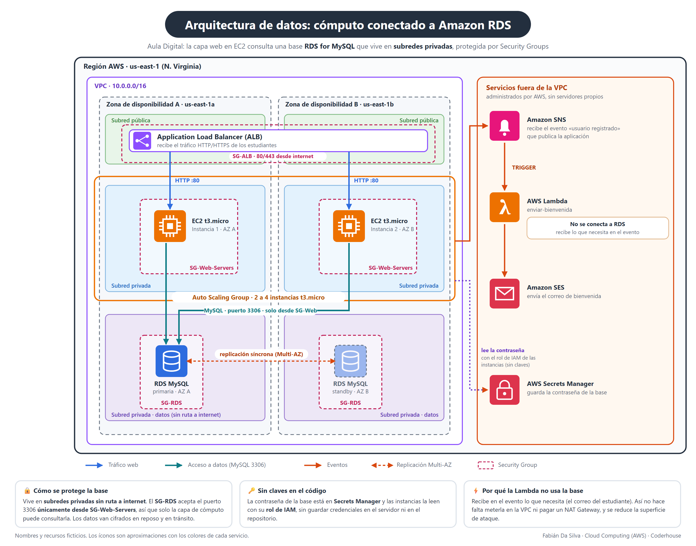

# Pre-entrega 5 · Arquitectura de datos: RDS vs. DynamoDB

Documento de arquitectura de datos de **Aula Digital**, la plataforma educativa que se viene diseñando en las entregas anteriores: sitio web servido por un Application Load Balancer, instancias EC2 en Auto Scaling y una Lambda que envía el correo de bienvenida. Esta entrega define dónde y cómo se guardan sus datos.

**Decisión:** Amazon **RDS for MySQL**, en subredes privadas, accesible solo desde la capa de cómputo.

---

## 1. Requisitos de datos de la aplicación

Primero, qué datos maneja la aplicación y qué exige cada uno.

| Dato | Qué guarda | Relaciones | Volumen y escala | Consistencia | Estructura |
| --- | --- | --- | --- | --- | --- |
| **Perfiles** de estudiantes y docentes | Nombre, correo, rol | Pocas, con inscripciones | Miles de usuarios, crecimiento gradual | Alta (el correo debe ser único) | Fija |
| **Catálogo** de cursos y lecciones | Cursos, módulos, lecciones, precios | Muchas: curso → módulos → lecciones, y categorías | Cientos o miles de filas, muy leídas | Media | Fija |
| **Inscripciones y pagos** | Quién compró qué, monto y fecha | Muchas: estudiante ↔ curso ↔ pago | Crece con las ventas | **Crítica**: transacciones | Fija |
| **Progreso** de lecciones | Lecciones completadas por estudiante | Media: estudiante ↔ lección | Muchas escrituras pequeñas | Media | Simple |
| **Eventos de uso** (a futuro) | Cada clic o reproducción | Ninguna | Potencialmente millones por día | Baja | Flexible |

**Conclusión del análisis:** casi todo es **relacional y de estructura fija**, con relaciones entre entidades y una parte (inscripciones y pagos) donde la consistencia es obligatoria. Solo los eventos de uso, que todavía no existen, tendrían un perfil distinto.

## 2. Cuadro comparativo: RDS vs. DynamoDB para este caso

| Criterio | Amazon RDS (MySQL) | Amazon DynamoDB | Encaje con Aula Digital |
| --- | --- | --- | --- |
| **Modelo de datos** | Relacional: tablas, filas y columnas | NoSQL: clave-valor y documentos | Los datos son relacionales → **RDS** |
| **Relaciones y JOINs** | Sí, con SQL estándar | **No soporta JOINs** | Panel del alumno y reportes cruzan varias tablas → **RDS** |
| **Transacciones** | Transacciones ACID con SQL | Disponibles, pero orientadas al acceso por clave | Inscripción y pago deben ir juntos → **RDS** |
| **Esquema** | Fijo y validado por el motor | Flexible, sin esquema rígido | Estructura fija → **RDS** |
| **Consultas y reportes** | SQL libre, sin diseñarlas de antemano | Hay que diseñar los patrones de acceso desde el principio | Reportes de ventas por curso y mes → **RDS** |
| **Escalabilidad** | Instancia más grande y réplicas de lectura | Horizontal y masiva, serverless | Tráfico gradual: no hace falta lo masivo → **RDS alcanza** |
| **Administración** | AWS parchea y respalda; se elige la instancia | Totalmente serverless | Ventaja de DynamoDB, pero RDS ya quita lo pesado |
| **Costo** | Instancia encendida todo el tiempo: hay un costo fijo mínimo | Se paga por uso: cercano a cero con poco tráfico | **Punto a favor de DynamoDB**; se compensa con una instancia pequeña |
| **Veredicto** | **Elegido** | Descartado por ahora | |

## 3. Justificación técnica

Elegí **Amazon RDS for MySQL** porque los datos de Aula Digital son relacionales y sus operaciones más importantes exigen consistencia.

**Primero, relaciones y JOINs.** Un estudiante se inscribe en varios cursos, cada curso tiene lecciones y cada inscripción genera pagos. Para armar el panel de un alumno, o un reporte de ventas por curso y por mes, hay que cruzar estas tablas con JOINs y consultas SQL libres. DynamoDB no soporta JOINs: habría que duplicar datos o resolver cada reporte en la aplicación.

**Segundo, transacciones confiables.** Inscribir a un estudiante y registrar su pago deben ocurrir juntos o no ocurrir. Una base relacional lo garantiza con transacciones ACID, algo vital en un sistema que maneja dinero.

**Tercero, esquema estable y carga predecible.** Los datos tienen una estructura fija y el tráfico crece de forma gradual, así que no necesito la escalabilidad masiva de DynamoDB. Una instancia pequeña alcanza.

**Costo y operación.** No elegí Aurora porque, para un proyecto inicial, es más potente (y más cara) de lo que el requerimiento pide. RDS administra los parches y los backups automáticos, con restauración a un punto en el tiempo, y Multi-AZ agrega una copia secundaria para producción.

Si el negocio crece y aparecen millones de eventos por segundo, como el seguimiento de cada clic, DynamoDB podría sumarse como complemento.

## 4. Diagrama de integración

La capa de cómputo (EC2 en Auto Scaling) se conecta con la nueva capa de datos (RDS). Es el diagrama de la pre-entrega 3 con la base de datos incorporada.

**Cómo se lee:**

- **Los estudiantes** llegan por el ALB (subred pública), que reparte el tráfico a las instancias EC2 de las dos zonas.
- **Las instancias EC2** consultan la base por el puerto 3306 de MySQL. Todas hablan con la instancia primaria.
- **RDS** corre en subredes privadas de datos, con una instancia primaria en la zona A y una secundaria en la zona B, sincronizadas.
- **La Lambda** de bienvenida **no** se conecta a la base: recibe lo que necesita en el evento de SNS.
- **La contraseña** de la base vive en AWS Secrets Manager y las instancias la leen con su rol de IAM.

## 5. Medidas de seguridad

La base nunca está expuesta a internet y solo la capa de cómputo puede consultarla.

| Medida | Cómo se aplica |
| --- | --- |
| **Aislamiento de red** | RDS en **subredes privadas** sin ruta hacia el Internet Gateway, y con acceso público desactivado. |
| **Security Group de la base** | `SG-RDS` acepta el puerto **3306 únicamente desde `SG-Web-Servers`**, el grupo de las instancias EC2. No se abre a ningún rango de IP. |
| **Security Group del cómputo** | `SG-Web-Servers` acepta el puerto 80 solo desde `SG-ALB`. Las instancias no son accesibles directamente. |
| **Credenciales** | La contraseña está en **AWS Secrets Manager**. Las instancias la leen con un **rol de IAM**, sin claves en el código ni en el servidor. |
| **Cifrado** | En reposo (cifrado de almacenamiento de RDS) y en tránsito (conexiones con TLS). |
| **Respaldo** | Backups automáticos con restauración a un punto en el tiempo, y snapshots manuales antes de cambios importantes. |
| **Mínimo privilegio** | La Lambda no tiene acceso a la base. El rol de las instancias solo puede leer el secreto que necesita. |

## 6. Configuración propuesta y costos

| Parámetro | Valor propuesto |
| --- | --- |
| **Motor** | MySQL |
| **Clase de instancia** | Una clase pequeña de uso general (por ejemplo, `db.t3.micro`) |
| **Almacenamiento** | 20 GiB de SSD |
| **Alta disponibilidad** | **Multi-AZ en producción**, con una secundaria en otra zona. **En desarrollo, una sola zona** para no duplicar el costo. |
| **Retención de backups** | 7 días |

**Sobre los costos.** RDS cobra mientras la instancia esté encendida, aunque no haya tráfico. Por eso la propuesta empieza con una instancia pequeña y una sola zona en desarrollo, y no se despliega nada hasta que haga falta. Esta entrega es de diseño: no crea recursos en AWS.

Los valores de clase de instancia y almacenamiento son una propuesta de partida y se ajustan con el uso real.
