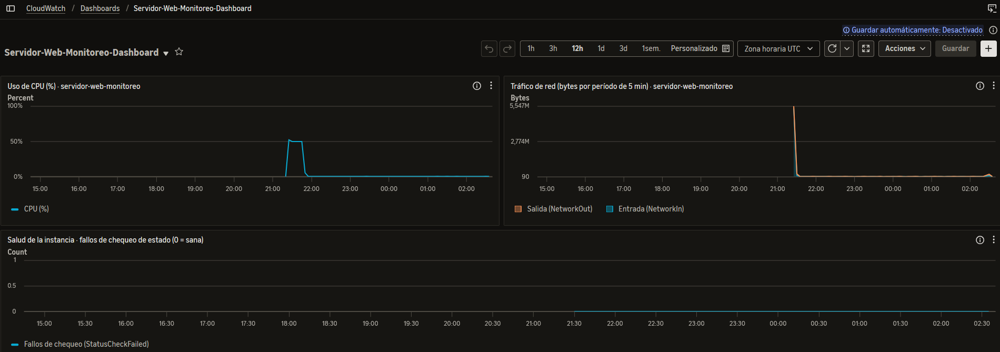
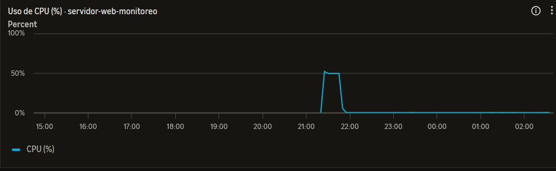
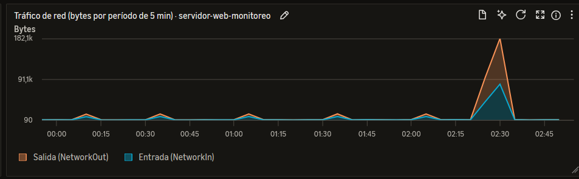
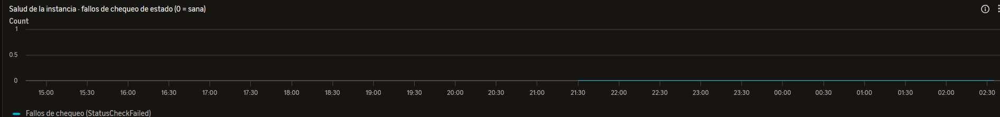

# Módulo 7 · Dashboard de monitoreo con Amazon CloudWatch

Dashboard de CloudWatch para monitorear una instancia EC2 de servidor web en una VPC: uso de CPU, tráfico de red y salud de la instancia. Extiende la infraestructura de módulos anteriores (EC2 en una VPC) con un sistema de monitoreo visual.

- **Dashboard:** `Servidor-Web-Monitoreo-Dashboard`
- **Definición en JSON:** [`dashboard.json`](dashboard.json)
- **Región:** `us-east-1` (N. Virginia)
- **Instancia monitoreada:** `servidor-web-monitoreo`, una `t3.micro` con Amazon Linux 2023 y Apache, en la VPC por defecto. El ID de instancia del JSON es el de esa instancia, que se terminó al finalizar el ejercicio.

## 📸 Evidencia

**Dashboard completo**, con los tres widgets y datos reales:



**Widget 1 · Uso de CPU:**



**Widget 2 · Tráfico de red:**



**Widget 3 · Salud de la instancia:**



## 📊 Qué muestra el dashboard

Los tres widgets usan métricas del espacio de nombres `AWS/EC2`, filtradas por el ID de la instancia.

### 1. Uso de CPU (%) · gráfico de líneas

- **Métrica:** `CPUUtilization`, con estadística *Average* y período de 5 minutos.
- **Qué significa:** el porcentaje de la capacidad de procesamiento que la instancia está usando. Va de 0 a 100, y el eje del gráfico está fijado en ese rango.
- **Cómo leerla:**
  - Cerca de 0 a 5 %: la instancia está ociosa.
  - Valores altos sostenidos (por ejemplo, más del 80 % durante varios períodos): la instancia está al límite y habría que usar un tipo más grande o sumar instancias.
  - Un pico que se repite siempre a la misma hora indica un patrón de demanda, útil para planificar capacidad.
- **Nota:** en las instancias `t3` la CPU es *burstable*, con créditos. Un uso alto y prolongado puede agotarlos.

### 2. Tráfico de red · gráfico de área apilada

- **Métricas:** `NetworkIn` y `NetworkOut`, con estadística *Sum* y período de 5 minutos.
- **Qué significan:** `NetworkIn` es la cantidad de bytes que **entran** a la instancia (por ejemplo, las peticiones HTTP de los visitantes). `NetworkOut` son los bytes que **salen** (por ejemplo, las páginas que responde el servidor).
- **Cómo leerlas:** cada punto es el **total de bytes en esos 5 minutos**, no una velocidad. El área apilada permite ver cuánto del tráfico total es de entrada y cuánto de salida. Al generar visitas con `curl`, los valores suben pasados unos minutos.
- **Costo:** la transferencia de entrada a AWS es gratuita. La de salida a internet se cobra por GB, así que `NetworkOut` es la más importante de vigilar en la factura.

### 3. Salud de la instancia · gráfico de líneas

- **Métrica:** `StatusCheckFailed`, con estadística *Maximum* y período de 5 minutos.
- **Qué significa:** vale **0** cuando la instancia pasa los chequeos de estado de EC2 (del sistema y de la propia instancia) y **1** si alguno falla. Es la señal más directa de que la máquina está sana.
- **Cómo leerla:** una línea plana en 0 es lo normal. Un 1 sostenido indica un problema que justificaría una alarma.

## 🧱 Cómo está hecho

1. Se lanzó una instancia EC2 `t3.micro` (Amazon Linux 2023) en la VPC por defecto, con Apache instalado por datos de usuario y un grupo de seguridad que solo permite el puerto 80 desde mi IP.
2. Se reemplazó el ID de instancia de ejemplo del JSON por el de la instancia real y se desplegó el dashboard desde la CLI:

```bash
aws cloudwatch put-dashboard --dashboard-name Servidor-Web-Monitoreo-Dashboard \
  --dashboard-body file://dashboard.json
```

3. Se generó tráfico HTTP con `curl` para que las métricas tuvieran datos, y se esperó unos minutos a que aparecieran en los gráficos.
4. Se tomaron las capturas de la carpeta [`capturas/`](capturas/).
5. Al terminar, se borró el dashboard y se terminó la instancia para no gastar crédito.

Para ver o exportar la definición de un dashboard existente:

```bash
aws cloudwatch get-dashboard --dashboard-name Servidor-Web-Monitoreo-Dashboard \
  --query DashboardBody --output text
```

### Estructura del JSON

El archivo sigue el formato de definición de dashboards de CloudWatch: una lista `widgets` donde cada widget es de tipo `metric`, con su posición (`x`, `y`, `width`, `height`) y sus propiedades.

| Propiedad | Qué hace |
| --- | --- |
| `title` | Etiqueta visible del widget. |
| `view` | `timeSeries`: gráfico en el tiempo. |
| `stacked` | `false` para líneas (CPU, salud) y `true` para área apilada (red). |
| `metrics` | Lista `[espacio de nombres, métrica, dimensión, valor]`. La dimensión es `InstanceId`. El `label` es el nombre de la serie en la leyenda. |
| `stat` y `period` | Estadística (`Average`, `Sum` o `Maximum`) y período en segundos (300 = 5 minutos). |
| `region` | Región donde están las métricas. |
| `yAxis` | Rango fijo del eje vertical. |

El formato JSON no admite comentarios, por eso la explicación de cada sección está en esta tabla.

## ✅ Validación

La definición se desplegó con `aws cloudwatch put-dashboard` y la API respondió `"DashboardValidationMessages": []`, es decir, sin errores de formato. Con la instancia en ejecución y tráfico generado, los tres widgets mostraron datos.

## ⚠️ Limitaciones y errores comunes que se tuvieron en cuenta

- **Instancia apagada:** si la instancia no está en ejecución, las métricas no tienen datos y las líneas salen vacías. Se verificó que estuviera `running`.
- **Instancia correcta:** con varias instancias, el ID del JSON debe ser el de la que pertenece a la VPC de desarrollo.
- **Métricas básicas:** EC2 publica métricas cada 5 minutos sin costo. Las de 1 minuto (monitoreo detallado) se cobran.
- **Lo que CloudWatch no ve por defecto:** la memoria RAM y los logs internos del sistema operativo. Para eso hace falta instalar el **CloudWatch Agent**.
- **Alarmas:** el dashboard solo muestra datos. Para que alguien se entere de un problema habría que crear alarmas asociadas a **Amazon SNS**.

## 🔎 CloudWatch vs. CloudTrail

- **CloudWatch:** operaciones. Mide el rendimiento y la salud de los recursos.
- **CloudTrail:** auditoría. Registra quién hizo qué a través de la API de AWS.

## 💸 Costos y limpieza

El ejercicio se hizo en una sola sesión: se lanzó la instancia, se desplegó el dashboard, se tomaron las capturas y se borró todo. Una `t3.micro` cuesta centavos por hora y las métricas básicas de EC2 son gratuitas.
