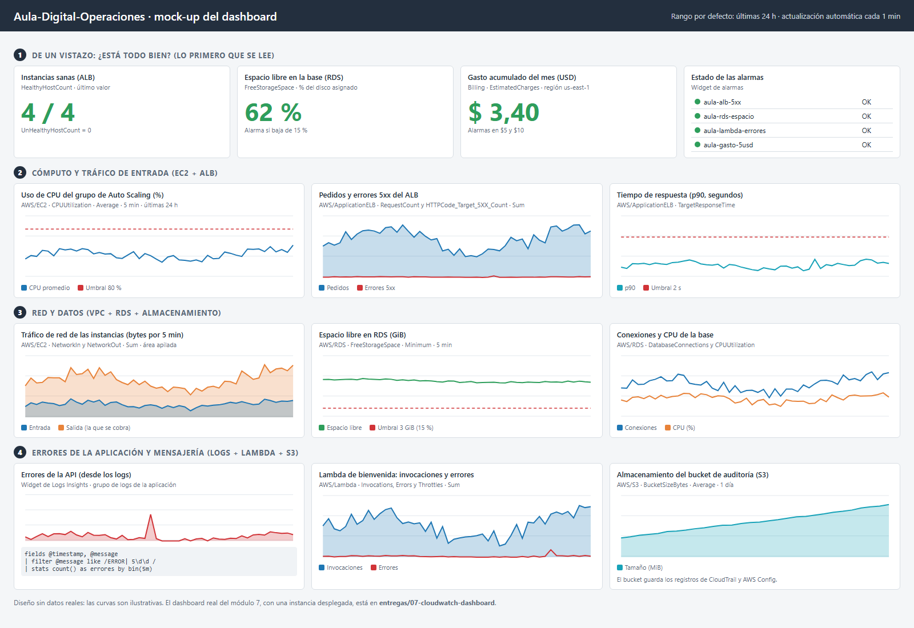

# Pre-entrega 7 · Plan de monitoreo y auditoría de Aula Digital

Plan de **monitoreo, alertas y auditoría** para **Aula Digital**, la plataforma educativa de las entregas anteriores: un Application Load Balancer, instancias EC2 en Auto Scaling en dos zonas, una base de datos Amazon RDS for MySQL en subredes privadas y una Lambda que envía el correo de bienvenida.

Esta entrega es de **diseño**: define qué se mide, cuándo se avisa y cómo se audita. No crea recursos en AWS ni genera costos. El dashboard desplegado de verdad, con una instancia real y capturas, está en el [módulo 7](../07-cloudwatch-dashboard/README.md).

**Supuestos del diseño:** región `us-east-1`, base RDS con **20 GiB** de almacenamiento asignado y un correo de administración de ejemplo (`admin@example.com`).

## Contenido

1. [Recursos a monitorear y métricas críticas](#1-recursos-a-monitorear-y-métricas-críticas)
2. [Matriz de alarmas](#2-matriz-de-alarmas)
3. [Mock-up del dashboard](#3-mock-up-del-dashboard)
4. [Plan de auditoría: CloudTrail y AWS Config](#4-plan-de-auditoría-cloudtrail-y-aws-config)
5. [Cómo se pondría en marcha](#5-cómo-se-pondría-en-marcha)
6. [Errores comunes que se tuvieron en cuenta](#6-errores-comunes-que-se-tuvieron-en-cuenta)

---

## 1. Recursos a monitorear y métricas críticas

Se identificaron **seis servicios** de la arquitectura (el enunciado pide al menos tres), cada uno con **al menos dos métricas** críticas.

| Servicio | Por qué importa | Métrica 1 | Métrica 2 | Otras |
| --- | --- | --- | --- | --- |
| **EC2 (Auto Scaling)** | Sirve la aplicación | `CPUUtilization` | `StatusCheckFailed` | `NetworkIn`, `NetworkOut` |
| **ALB** | Es la única entrada de los estudiantes | `HTTPCode_Target_5XX_Count` | `TargetResponseTime` | `UnHealthyHostCount`, `HealthyHostCount`, `RequestCount` |
| **RDS MySQL** | Guarda inscripciones y pagos | `FreeStorageSpace` | `CPUUtilization` | `DatabaseConnections`, `FreeableMemory` |
| **Lambda (bienvenida)** | Un fallo es un alumno sin correo | `Errors` | `Throttles` | `Duration`, `Invocations` |
| **S3 (bucket de auditoría)** | Guarda los registros de CloudTrail y AWS Config | `BucketSizeBytes` | `NumberOfObjects` | |
| **Facturación** | Evita sorpresas en la cuenta | `EstimatedCharges` | | |

**Qué mide cada una y por qué se eligió:**

- **`CPUUtilization` (EC2):** porcentaje de procesamiento en uso. Sostenido en valores altos indica que faltan instancias.
- **`StatusCheckFailed` (EC2):** vale 0 si la instancia pasa los chequeos de estado y 1 si falla alguno. Es la señal más directa de que una máquina no está sana.
- **`HTTPCode_Target_5XX_Count` (ALB):** respuestas de error generadas por las instancias. Es el síntoma que ve el estudiante.
- **`TargetResponseTime` (ALB):** cuánto tarda la aplicación en responder. Sube antes de que el sitio caiga.
- **`FreeStorageSpace` (RDS):** espacio libre del disco, en bytes. Si se llena, la base deja de aceptar escrituras.
- **`CPUUtilization` (RDS):** una consulta mal escrita o un pico de inscripciones satura la base.
- **`Errors` y `Throttles` (Lambda):** invocaciones que fallan o que AWS rechaza por exceder el límite de concurrencia.
- **`BucketSizeBytes` (S3):** el bucket de auditoría solo crece; esta métrica anticipa el costo de almacenamiento.
- **`EstimatedCharges` (Billing):** gasto acumulado estimado del mes.

**Dos aclaraciones sobre lo que CloudWatch ve por defecto:**

- Las métricas básicas de EC2 se publican cada 5 minutos. La **memoria RAM** y los **logs de la aplicación** no existen sin instalar el **CloudWatch Agent**. Por eso el dashboard de errores de la API (sección 3) depende del agente.
- `EstimatedCharges` solo existe en `us-east-1` y requiere activar *Receive CloudWatch billing alerts* en las preferencias de facturación (una vez, desde el usuario raíz o con acceso de IAM a la facturación habilitado).

## 2. Matriz de alarmas

Todas las alarmas notifican a un único **tópico de Amazon SNS**, `aula-digital-alertas`, con una suscripción de correo a `admin@example.com`. La alarma de facturación tiene que estar en `us-east-1`, igual que el tópico al que notifica.

| # | Alarma | Métrica (espacio de nombres) | Condición (umbral) | Período | Evaluación | Datos faltantes | Acción |
| --- | --- | --- | --- | --- | --- | --- | --- |
| 1 | `aula-ec2-cpu-alta` | `CPUUtilization` · Average (`AWS/EC2`, por grupo de Auto Scaling) | **> 80 %** | 5 min | 3 de 3 períodos (15 min seguidos) | No incumple | Correo vía SNS |
| 2 | `aula-ec2-estado` | `StatusCheckFailed` · Maximum (`AWS/EC2`) | **≥ 1** | 5 min | 2 de 2 | Incumple | Correo vía SNS |
| 3 | `aula-alb-5xx` | `HTTPCode_Target_5XX_Count` · Sum (`AWS/ApplicationELB`) | **≥ 10** errores | 5 min | 2 de 3 | No incumple | Correo vía SNS |
| 4 | `aula-alb-latencia` | `TargetResponseTime` · p90 (`AWS/ApplicationELB`) | **> 2 s** | 5 min | 3 de 3 | No incumple | Correo vía SNS |
| 5 | `aula-alb-hosts-caidos` | `UnHealthyHostCount` · Maximum (`AWS/ApplicationELB`) | **≥ 1** | 5 min | 2 de 2 | No incumple | Correo vía SNS |
| 6 | `aula-rds-espacio` | `FreeStorageSpace` · Minimum (`AWS/RDS`) | **< 3 GiB** (= 15 % de 20 GiB, 3 221 225 472 bytes) | 5 min | 2 de 2 | Incumple | Correo vía SNS |
| 7 | `aula-rds-cpu` | `CPUUtilization` · Average (`AWS/RDS`) | **> 80 %** | 5 min | 3 de 3 | No incumple | Correo vía SNS |
| 8 | `aula-lambda-errores` | `Errors` · Sum (`AWS/Lambda`) | **≥ 1** | 5 min | 1 de 1 | No incumple | Correo vía SNS |
| 9 | `aula-lambda-throttles` | `Throttles` · Sum (`AWS/Lambda`) | **≥ 1** | 5 min | 1 de 1 | No incumple | Correo vía SNS |
| 10 | `aula-gasto-5usd` | `EstimatedCharges` · Maximum (`AWS/Billing`, `Currency=USD`) | **> 5 USD** (aviso) | 6 h | 1 de 1 | No incumple | Correo vía SNS |
| 11 | `aula-gasto-10usd` | `EstimatedCharges` · Maximum (`AWS/Billing`, `Currency=USD`) | **> 10 USD** (crítica) | 6 h | 1 de 1 | No incumple | Correo vía SNS |

**Por qué estos umbrales y períodos:**

- **Períodos de 5 minutos y evaluación de varios períodos** (columna *Evaluación*): una alarma con "3 de 3" solo se dispara si el problema dura 15 minutos seguidos. Así un pico momentáneo no genera una alerta (ver sección 6).
- **Alarma 6, RDS sin espacio:** la métrica `FreeStorageSpace` viene en bytes, no en porcentaje. Se calculó el 15 % sobre los 20 GiB asignados. Si se cambia el tamaño del disco, hay que recalcular el umbral.
- **Alarmas 2, 6: datos faltantes como "incumple":** si una instancia o la base dejan de publicar métricas, es una señal de problema, no de calma. En las demás se usa "no incumple" para que la ausencia de tráfico, por ejemplo de madrugada, no dispare alertas falsas.
- **Alarma 8, Lambda con umbral de 1 error:** la función se invoca pocas veces; un solo error ya es un alumno que no recibió su correo de bienvenida. Es la excepción a la regla de los umbrales altos, y se justifica por el bajo volumen.
- **Alarmas 10 y 11, facturación:** son obligatorias en cualquier proyecto cloud. Dos niveles: un aviso a los 5 USD y una alerta crítica a los 10 USD. Los datos de facturación se actualizan varias veces por día, por eso el período es de 6 horas. `EstimatedCharges` muestra el **gasto acumulado del mes**, no una proyección. Para una proyección se complementa con **AWS Budgets** o Cost Explorer.

**El tópico SNS:** al suscribir el correo, AWS envía un mensaje con un enlace de confirmación. Hasta que no se confirma, la suscripción queda *Pendiente* y no llega ninguna alerta.

## 3. Mock-up del dashboard

Dashboard `Aula-Digital-Operaciones`, pensado para el administrador de la plataforma. Está ordenado de arriba hacia abajo, de lo más urgente a lo más detallado.



| Fila | Qué se ve | Widgets | Pregunta que responde |
| --- | --- | --- | --- |
| **1. De un vistazo** | Salud, espacio, gasto y alarmas | 3 números grandes (instancias sanas del ALB, espacio libre de RDS en %, gasto acumulado del mes) y un widget de **estado de las alarmas** | ¿Está todo bien? |
| **2. Cómputo y tráfico de entrada** | CPU, pedidos y latencia | Líneas de `CPUUtilization` del grupo de Auto Scaling (con línea de umbral en 80 %), `RequestCount` junto a `HTTPCode_Target_5XX_Count`, y `TargetResponseTime` p90 | ¿Aguanta la carga? |
| **3. Red y datos** | Red, base de datos y almacenamiento | Área apilada de `NetworkIn` y `NetworkOut`, `FreeStorageSpace` de RDS (con línea en 3 GiB), `DatabaseConnections` junto a la CPU de la base | ¿Se llena algo? ¿Se satura la base? |
| **4. Errores y mensajería** | Logs, Lambda y almacenamiento de auditoría | Widget de **Logs Insights** con los errores de la API, `Invocations` y `Errors` de la Lambda, y `BucketSizeBytes` del bucket de auditoría | ¿Qué falla y por dónde? |

**Decisiones del diseño:**

- **Lo primero que se lee** es la fila 1: números grandes y un semáforo de alarmas. Si todo está en verde, no hace falta bajar.
- **Líneas de umbral** (rojas, punteadas) en los gráficos que tienen alarma: se ve qué tan cerca está cada métrica de disparar.
- **Rango de 24 h** por defecto, con actualización cada minuto.
- **Errores de la API:** el widget de Logs Insights usa esta consulta sobre el grupo de logs de la aplicación (necesita el CloudWatch Agent):

```
fields @timestamp, @message
| filter @message like /ERROR| 5\d\d /
| stats count() as errores by bin(5m)
```

- **Gasto en el dashboard:** el widget de gasto usa `EstimatedCharges` en `us-east-1`. Un dashboard puede mostrar métricas de otra región.

El módulo 7 contiene un dashboard real de este tipo, con tres widgets y datos reales de una instancia EC2.

## 4. Plan de auditoría: CloudTrail y AWS Config

Se usan tres servicios con roles distintos:

| Servicio | Pregunta que responde | Uso en Aula Digital |
| --- | --- | --- |
| **CloudWatch** | ¿Cómo está funcionando? | Métricas, logs y alarmas (secciones 1 a 3) |
| **CloudTrail** | ¿**Quién** hizo **qué** y **cuándo**? | Registro de cada llamada a la API de AWS |
| **AWS Config** | ¿Cómo está **configurado** y **cumple** las reglas? | Historial de configuración y evaluación de reglas |

### 4.1 CloudTrail: registrar todos los cambios

**Por qué hace falta crear un trail:** CloudTrail guarda por defecto los últimos 90 días de eventos de administración, pero solo en la consola (*Historial de eventos*). Para conservarlos más tiempo y poder consultarlos o alertar sobre ellos, hay que crear un *trail* que los escriba en S3.

**Configuración propuesta:**

| Ajuste | Valor | Motivo |
| --- | --- | --- |
| Nombre | `aula-digital-auditoria` | |
| Alcance | **Todas las regiones** | Un atacante podría crear recursos en una región que nadie mira |
| Eventos | **De administración**, lectura y escritura | Cubren los cambios de red, seguridad y base de datos |
| Eventos de datos (S3, Lambda) | Desactivados al inicio | Generan mucho volumen y tienen costo; se activan solo para buckets sensibles |
| Destino | Bucket S3 dedicado, `aula-digital-auditoria-<cuenta>` | Separado del resto de los datos |
| Validación de integridad | **Activada** | Permite demostrar que los registros no se alteraron |
| Cifrado del bucket | SSE (S3 o KMS) | |
| Acceso del bucket | *Block Public Access* activado; solo CloudTrail y Config pueden escribir | El bucket de auditoría no puede ser público |
| Envío a CloudWatch Logs | Activado | Permite crear filtros de métricas y alarmas sobre los eventos |

### 4.2 Qué evento de CloudTrail avisa de un cambio crítico en la red

Estos son los eventos de la red y la base de datos de Aula Digital que se quieren detectar. Cada uno se vigila con una **regla de EventBridge** que reacciona a eventos de CloudTrail y avisa por el mismo tópico SNS (`aula-digital-alertas`).

| Evento de CloudTrail | Qué significa | Por qué es crítico |
| --- | --- | --- |
| `AuthorizeSecurityGroupIngress` | Se abrió un puerto en un Security Group | Es la forma típica de exponer por error `SG-RDS` o `SG-Web-Servers` |
| `RevokeSecurityGroupIngress` | Se cerró una regla de entrada | Puede cortar el acceso del ALB o de la base |
| `AuthorizeSecurityGroupEgress` / `RevokeSecurityGroupEgress` | Cambió el tráfico de salida | Puede permitir fuga de datos o romper dependencias |
| `ModifySecurityGroupRules` | Se editaron reglas existentes | Cambio en reglas sin crear ni borrar nada |
| `DeleteSecurityGroup` | Se borró un Security Group | Pérdida de una barrera de seguridad |
| **`DeleteVpc`** | **Se eliminó la VPC** | **Es el cambio más grave: apaga toda la red** |
| `DeleteSubnet`, `DeleteRouteTable`, `DeleteRoute`, `ReplaceRoute` | Cambió el enrutamiento | Puede dejar una subred privada con ruta a internet |
| `DetachInternetGateway`, `DeleteInternetGateway` | Se quitó la salida a internet | El ALB deja de ser alcanzable |
| `ModifyDBInstance` | Se modificó la base de datos | Por ejemplo, activar el acceso público |
| `DeleteDBInstance` | Se eliminó la base | Pérdida de datos |
| `StopLogging`, `DeleteTrail` | Se apagó la auditoría | Alguien intenta borrar sus huellas |

**Ejemplo de patrón de la regla de EventBridge** para avisar ante cambios en los Security Groups y en la VPC:

```json
{
  "source": ["aws.ec2"],
  "detail-type": ["AWS API Call via CloudTrail"],
  "detail": {
    "eventSource": ["ec2.amazonaws.com"],
    "eventName": [
      "AuthorizeSecurityGroupIngress",
      "RevokeSecurityGroupIngress",
      "AuthorizeSecurityGroupEgress",
      "RevokeSecurityGroupEgress",
      "ModifySecurityGroupRules",
      "DeleteSecurityGroup",
      "DeleteVpc"
    ]
  }
}
```

**Cómo se averigua quién modificó un Security Group.** El evento de CloudTrail trae, entre otros datos: `userIdentity` (quién), `eventTime` (cuándo), `sourceIPAddress` (desde dónde) y `requestParameters` (qué cambió, con el ID del grupo y el puerto). Desde la CLI:

```bash
aws cloudtrail lookup-events \
  --lookup-attributes AttributeKey=EventName,AttributeValue=AuthorizeSecurityGroupIngress \
  --max-results 10
```

### 4.3 AWS Config: reglas de cumplimiento

**Configuración base:** se activa el *Configuration Recorder* para todos los recursos soportados, incluidos los globales, con un *Delivery Channel* hacia el bucket de auditoría y notificaciones al tópico SNS.

**Cinco reglas administradas** (el enunciado pide tres):

| # | Regla | Identificador | Qué verifica | Riesgo que cubre |
| --- | --- | --- | --- | --- |
| 1 | `s3-bucket-public-read-prohibited` | `S3_BUCKET_PUBLIC_READ_PROHIBITED` | Ningún bucket permite lectura pública | Filtración de datos, incluido el bucket de auditoría |
| 2 | `restricted-ssh` | `INCOMING_SSH_DISABLED` | Ningún Security Group abre el puerto 22 a `0.0.0.0/0` | Acceso remoto abierto a todo internet |
| 3 | `rds-instance-public-access-check` | `RDS_INSTANCE_PUBLIC_ACCESS_CHECK` | La base no es accesible públicamente | Mantiene RDS en subredes privadas, como se diseñó |
| 4 | `rds-storage-encrypted` | `RDS_STORAGE_ENCRYPTED` | El almacenamiento de RDS está cifrado | Cifrado en reposo, requisito del diseño de datos |
| 5 | `cloudtrail-enabled` | `CLOUD_TRAIL_ENABLED` | Hay un trail de CloudTrail activo | Garantiza que la auditoría siga encendida |

**Cómo se combinan CloudTrail y Config:** son complementarios.

- **Config** detecta que algo **dejó de cumplir** la regla (por ejemplo, `restricted-ssh` pasa a *NON_COMPLIANT*).
- **CloudTrail** dice **quién** hizo ese cambio y desde dónde.

**Límite importante:** Config es una herramienta **detectiva**, no preventiva. Marca el incumplimiento, pero no impide el cambio. Para corregirlo automáticamente se puede agregar una **remediación** con un documento de Systems Manager Automation (por ejemplo, `AWS-DisableS3BucketPublicReadWrite` para buckets públicos). Para **prevenir**, se usan permisos de IAM o políticas de control de servicios (SCP) de AWS Organizations.

## 5. Cómo se pondría en marcha

Orden sugerido, de lo más barato y urgente a lo más completo. Nada de esto se ejecutó en esta entrega.

1. **Alarma de facturación y tópico SNS** (primero, antes de crear cualquier recurso que cueste): activar *Receive CloudWatch billing alerts*, crear el tópico, confirmar la suscripción y crear las alarmas 10 y 11. Se complementa con un presupuesto en AWS Budgets.
2. **CloudTrail:** crear el bucket y el trail `aula-digital-auditoria`.
3. **AWS Config:** activar el recorder y las cinco reglas.
4. **Alarmas técnicas** (1 a 9), a medida que se despliegue cada servicio.
5. **CloudWatch Agent** en las instancias, para memoria RAM y logs de la aplicación.
6. **Dashboard:** crear `Aula-Digital-Operaciones` desde el diseño de la sección 3.

**Costos de tenerlo encendido:** las métricas básicas de EC2 y las alarmas de los primeros niveles tienen capa gratuita; CloudTrail guarda sin costo la primera copia de los eventos de administración por región, y se paga el almacenamiento en S3; Config cobra por cada cambio de configuración registrado y por cada evaluación de regla. Con una cuenta chica, el costo es de centavos al mes, y es mucho menor que el de una brecha o una caída sin aviso.

## 6. Errores comunes que se tuvieron en cuenta

- **Alarmas ruidosas:** por eso todos los períodos son de 5 minutos o más, y las alarmas sensibles exigen **varios períodos seguidos** en incumplimiento antes de avisar. Un umbral bajo que se dispara a cada rato hace que se ignoren las alertas reales.
- **Olvidar la facturación:** hay dos alarmas de `EstimatedCharges` (5 y 10 USD), y se aclara que muestran gasto acumulado, no proyectado.
- **Una alarma sin destinatario no sirve:** las 11 alarmas apuntan a un tópico SNS, y se explica que hay que confirmar la suscripción del correo.
- **Umbral en bytes, no en porcentaje:** `FreeStorageSpace` se mide en bytes; el 15 % se calculó sobre el tamaño del disco.
- **Auditar solo desde la consola:** el historial de CloudTrail de 90 días no alcanza; se crea un trail con destino en S3.
- **Auditoría que se puede apagar sin que nadie se entere:** `StopLogging` y `DeleteTrail` tienen su propia alerta, y la regla `cloudtrail-enabled` de Config verifica que el trail siga activo.
- **El bucket de auditoría también es un bucket:** se protege con *Block Public Access* y la regla de lectura pública de Config lo cubre.
